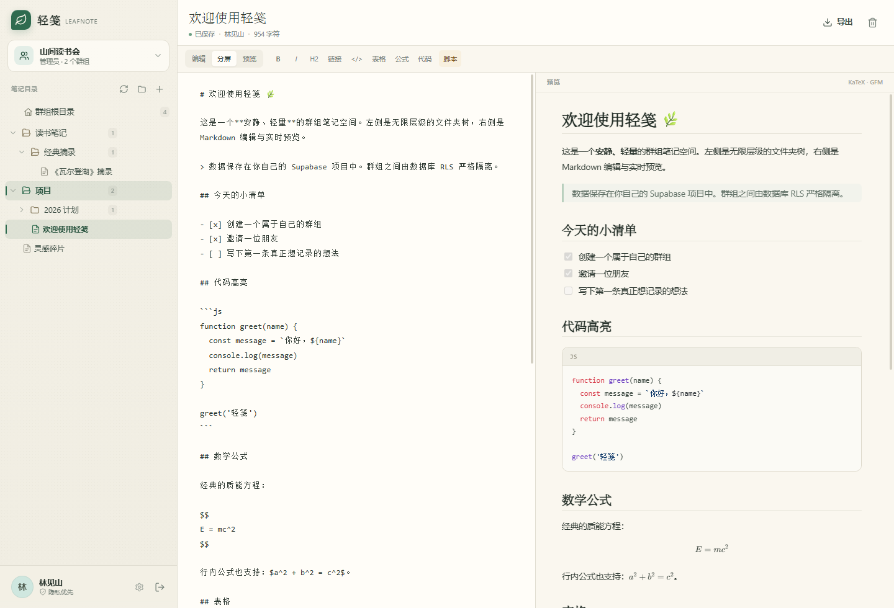
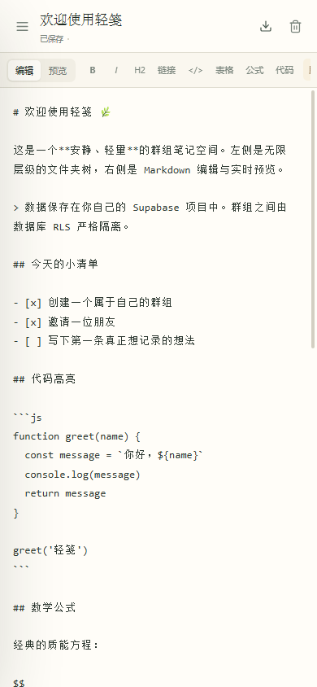
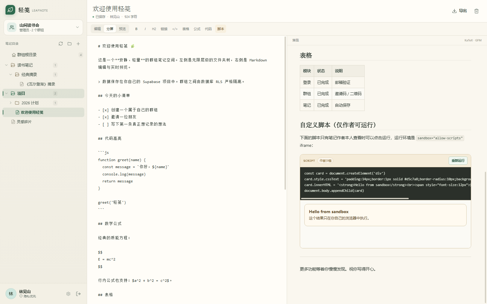

# 轻笺 LeafNote

轻量、隐私优先的群组 Markdown 笔记。纯静态前端，部署在 GitHub Pages，数据与认证全部使用 Supabase，无自建后端、无 WebDAV、无重型 UI 框架。

| 桌面端分屏编辑 | 移动端 |
| --- | --- |
|  |  |

## 功能

- **邮箱注册 + 邮箱验证**：注册后必须完成验证邮件才能进入工作区。
- **个人资料**：修改用户名、上传头像；可选绑定手机号（需配置 Supabase Phone Provider / 短信服务）。
- **实名信息**：独立敏感数据表；只能被同组组员按群组设置读取，组外用户无法读取。
- **群组**：单个账号可创建无限多个群组；管理员 / 普通组员两种角色；所有成员都能生成邀请码和邀请二维码。
- **群组管理**：群主可转让群组、任免管理员、移除成员；成员可退出群组。
- **群组隔离**：组外用户无法访问笔记、文件夹、成员资料、邀请码与实名信息，全部由数据库 RLS 执行。
- **无限层级文件夹树**：折叠 / 展开、子文件夹、重命名、删除；笔记自动按更新时间排序。
- **Markdown 编辑器 + 实时预览分屏**：GFM 表格、任务列表、代码高亮、KaTeX 公式、图片、引用等。
- **自定义脚本块**：仅笔记作者本人查看时可点击运行；其他成员只看到源码。运行环境是 `sandbox="allow-scripts"` iframe，且通过 CSP 禁止网络访问。
- **自动保存**：输入后约 0.85 秒自动写入 Supabase；断网时写入本地缓存，恢复网络后继续同步。
- **Markdown 导出**：一键下载当前笔记为 `.md` 文件。
- **PWA**：manifest、service worker、桌面快捷方式、应用外壳与已打开笔记的离线缓存。
- **运行时零外部 CDN**：字体、KaTeX、代码高亮等全部随构建产物打包，不请求 Google Fonts / jsDelivr 等资源。

## 技术栈

- Vue 3（Composition API）+ Vite
- `@supabase/supabase-js`（Auth / Postgres / Storage）
- `marked` + `DOMPurify` + `highlight.js` + `katex`
- `qrcode-generator`
- 原生 CSS，无 UI 组件库
- PWA：手写 `manifest.webmanifest` 与 service worker

生产构建中，主应用 JS 约 **103 KB gzip**，Supabase 客户端约 **59 KB**，Markdown / KaTeX / 代码高亮约 **110 KB**；KaTeX 字体随产物按需加载。运行时**不包含任何外部 CDN 请求**。

## 目录

```text
.
├── src/
│   ├── App.vue                    # 会话门禁 / 配置界面
│   ├── components/
│   │   ├── AuthView.vue           # 登录、注册、邮箱验证
│   │   ├── Workspace.vue          # 工作区状态、自动保存、离线缓存
│   │   ├── AppSidebar.vue         # 群组切换 + 目录树
│   │   ├── FolderTree.vue         # 递归文件夹树
│   │   ├── NoteEditor.vue         # 分屏编辑器 / 移动端编辑-预览切换
│   │   ├── MarkdownPreview.vue    # 安全渲染与脚本块水合
│   │   ├── ProfileDialog.vue      # 用户名 / 头像 / 实名 / 手机号
│   │   ├── GroupDialog.vue        # 成员 / 邀请 / 二维码 / 设置
│   │   └── ...
│   ├── lib/
│   │   ├── supabase.js
│   │   ├── markdown.js            # Markdown、KaTeX、sanitize、sandbox
│   │   ├── cache.js               # 离线笔记 / 目录缓存
│   │   └── ...
│   └── styles.css
├── supabase/schema.sql            # 建表、RPC、RLS、Storage 策略（唯一需要执行的 SQL）
├── public/                        # manifest、sw.js、图标
├── .github/workflows/deploy.yml   # GitHub Pages 自动部署
├── docs/                          # README 截图
└── .env.example
```

## 快速开始

### 1. 创建 Supabase 项目并执行 SQL

1. 打开 [Supabase Dashboard](https://supabase.com/dashboard) 创建项目（选择离用户较近的区域）。
2. 进入 **SQL Editor**，粘贴并执行 [`supabase/schema.sql`](supabase/schema.sql) 的完整内容。
3. SQL 会创建：
   - `profiles`、`groups`、`group_members`、`real_identities`、`invites`、`folders`、`notes`
   - 所有 RLS 策略、成员 / 邀请 / 实名相关 RPC
   - 私有 `avatars` Storage bucket 及对象策略
   - 新用户自动创建 profile 的触发器

> 建议在项目第一次开放注册前执行 SQL。若已有用户、资料页显示“个人资料尚未创建”，见文末排障。

### 2. 开启邮箱验证

在 Supabase **Authentication → Sign In / Providers → Email**：

- 开启 **Email** provider
- 开启 **Confirm email**
- 建议开启 **Secure email change**

应用只允许持有已验证邮箱的会话进入工作区。**如果关闭 Confirm email，Supabase 会自动确认邮箱，应用无法代替服务端强制验证**，请务必在 Dashboard 中开启。

### 3. 配置站点 URL 与重定向

在 **Authentication → URL Configuration**：

本地开发：

```text
Site URL:       http://localhost:5173/
Redirect URLs:  http://localhost:5173/
```

GitHub Pages：

```text
Site URL:       https://<你的用户名>.github.io/<仓库名>/
Redirect URLs:  https://<你的用户名>.github.io/<仓库名>/
```

邀请链接使用 `?invite=<CODE>` 查询参数，邮箱验证回跳时会保留它，登录后会自动弹出加入群组确认框。

### 4. 可选：手机号绑定

手机号绑定是可选功能，需要：

1. 在 **Authentication → Providers → Phone** 配置短信服务商（Twilio / MessageBird 等，可能产生费用）。
2. 在应用「个人资料 → 手机号绑定」中输入带国际区号的号码并验证短信验证码。
3. 未配置短信服务时，可完全跳过该模块，不影响核心功能。

手机号只用于认证，不写入公开资料，也不向组员展示。

### 5. 配置环境变量

```bash
cp .env.example .env
```

编辑 `.env`：

```dotenv
VITE_SUPABASE_URL=https://your-project-ref.supabase.co
VITE_SUPABASE_ANON_KEY=your-anon-key
```

> 只能使用 Dashboard 中的 **anon / publishable key**。绝对不要把 `service_role` key 放进前端文件、`.env.production` 或公开仓库。

### 6. 本地运行

要求 Node.js **20.19+**（推荐 22）与 pnpm 11：

```bash
pnpm install
pnpm dev
```

或使用 npm：

```bash
npm install
npm run dev
```

打开 `http://localhost:5173/`。

生产构建：

```bash
pnpm build
pnpm preview
```

> 本项目也接受 Supabase CLI 本地开发地址 `http://127.0.0.1:54321`，便于完全本地调试。

## 部署到 GitHub Pages

仓库已包含 [`.github/workflows/deploy.yml`](.github/workflows/deploy.yml)，并已为当前项目写入 [`.env.production`](.env.production)。

1. 将代码推到 GitHub 的 `main` 分支。
2. 工作流会自动启用/配置 GitHub Pages，并构建 `dist/` 后发布。
3. 如果仓库尚未启用 Pages，也可以在 **Settings → Pages → Build and deployment** 将 Source 设为 **GitHub Actions**。
4. 把部署后的 URL 填入 Supabase 的 **Site URL** 与 **Redirect URLs**。
5. 在 Supabase 确认 **Confirm email** 已开启。

> `.env.production` 中只有 Supabase **publishable / anon** key。该 key 本来就随前端 JS 公开，不是服务端密钥；请永远不要放入 `service_role`。如果换成另一个 Supabase 项目，修改该文件后重新推送即可。

Vite 使用 `base: './'`，因此项目页（`https://user.github.io/repo/`）和自定义域名都能直接工作，无需修改代码。部署步骤会生成 `dist/.nojekyll`，避免 GitHub Pages 的 Jekyll 处理。

### 关于国内访问

- 应用运行时**不加载任何第三方 CDN、字体、统计脚本或代理**；Vite 打包后的静态资源与 Supabase 请求是唯一网络依赖。
- GitHub Pages 与 Supabase 域名在部分网络环境下的连通性并不由本项目控制，无法通过前端代码保证 100% 直连。若 GitHub Pages 访问不稳定，可以将 `dist/` 原样放到任意静态托管/对象存储，代码无需修改；Supabase 可使用自定义域名。
- 不要为了“加速”把依赖改成公共 CDN，这会增加可用性与供应链风险。

## 数据模型与权限

| 表 | 作用 | 读取 | 写入 |
| --- | --- | --- | --- |
| `profiles` | 用户名、头像路径 | 自己 + 同组组员 | 仅本人（用户名/头像列） |
| `groups` | 群组、群主、实名可见性 | 仅组员 | 仅 RPC（管理员/群主校验） |
| `group_members` | 成员与角色 | 仅组员 | 仅 RPC |
| `real_identities` | 真实姓名、证件号 | 自己 + 满足同组可见性设置的用户 | 仅本人 |
| `invites` | 邀请码 | 仅组员 | 仅 RPC |
| `folders` | 无限层级文件夹 | 仅组员 | 组员新建；创建者/管理员修改删除 |
| `notes` | Markdown 笔记 | 仅组员 | 仅作者插入/修改/删除 |

关键设计：

1. **组外隔离**：`folders`、`notes`、`invites`、`profiles` 等表的 SELECT 均通过 `ln_is_group_member` / `ln_shares_group_with` 判定；组外账号查询结果为 0 行，即使直接调用 REST API 也无法绕过。
2. **成员、角色、邀请写入只走 `SECURITY DEFINER` RPC**：客户端没有 `groups` / `group_members` / `invites` 的直接写策略，避免绕过“仅管理员/仅群主”校验。
3. **实名信息双重限制**：
   - 独立表，不放在公开 profile 中；
   - 表级 RLS 限制为“自己或同组可见”；
   - 界面通过 `ln_get_group_real_identities(group_id)` 按**当前群组**的 `real_name_visibility` 返回数据，支持“全部组员 / 仅管理员 / 关闭展示”；
   - 群组外的用户完全无法读取。
4. **头像 Storage 为私有 bucket**：前端用短时签名 URL 加载；Storage 对象策略只允许本人写入，同组组员读取。
5. **笔记仅作者可编辑**：这是为脚本来源可信而做的安全取舍。其他组员能阅读，但不能修改内容或注入脚本。
6. **邀请码**由数据库随机 UUID 片段生成，可设置有效期、最大使用次数并撤销；普通组员也可创建。
7. **群组转让**仅群主可执行；转让后原群主变为普通组员，新群主成为管理员。群主还可以任免其他管理员。

## 实名可见性

群组设置提供三档：

| 值 | 效果 |
| --- | --- |
| `members` | 同组所有成员可查看实名信息（默认） |
| `admins` | 仅管理员可查看 |
| `off` | 组内不展示；仅本人可查看和修改 |

即使组内关闭展示，组外用户仍然无法读取数据。

## 自定义脚本块

在 Markdown 中使用语言标记 `script`：

````markdown
```script
const el = document.createElement('div')
el.textContent = 'Hello from ' + new Date().toLocaleTimeString()
document.body.appendChild(el)
```
````

安全规则：

- **只有笔记作者本人**查看时显示「运行脚本」按钮；其他成员只看到源码，不会创建 iframe、不会执行。
- 脚本只在 `sandbox="allow-scripts"` 的 iframe 中运行，**没有** `allow-same-origin`、`allow-forms`、`allow-popups`，无法读取父页面 DOM、Cookie、localStorage 或应用数据。
- iframe 内 CSP 为 `default-src 'none'`，禁止外部网络请求、图片和表单，避免脚本把笔记内容外传。
- 脚本需要作者主动点击才运行，不会在打开笔记时自动执行。
- 普通 Markdown 渲染先经 DOMPurify 清洗，禁止 `script`、`iframe`、`style`、表单与内联样式等标签/属性。



## 自动保存、离线与 PWA

- 编辑内容在输入后约 850ms 防抖保存到 Supabase；标题、正文、更新时间会同步。
- 本地 `localStorage` 会缓存：
  - 最近打开的笔记正文（最多 40 篇）
  - 当前账号的群组目录 / 文件夹树 / 笔记标题
  - 当前个人资料摘要
- 断网时继续编辑，状态显示「离线 · 已缓存」；恢复网络后自动重试保存。
- 退出登录会清理笔记、目录与资料缓存。
- service worker 预缓存应用外壳和静态资源；已打开过的笔记在离线冷启动时可通过缓存目录打开。
- 浏览器支持时可「添加到主屏幕 / 安装应用」。

> 本地缓存是同一浏览器用户下的明文数据，不属于端到端加密。共用设备请在离开前退出登录。

## 安全说明与边界

- RLS 与 RPC 只能保护数据库访问；Supabase 项目管理员 / 数据库持有者仍可看到明文数据。**本项目不提供端到端加密**。真实证件号等敏感信息请谨慎填写。
- 前端使用 anon key 是 Supabase 的标准设计，安全性来自 RLS。不要把 `service_role` key 写入任何前端文件。
- GitHub Actions 构建时通过 Secrets 注入 anon key；它最终会出现在静态 JS 中，这是预期行为。
- `DOMPurify` 清洗 Markdown 中的原始 HTML；脚本块走独立的 sandbox 执行路径。
- 邀请码等同于入组凭证，请只分享给可信成员；可设置使用次数和有效期，或随时撤销。
- 头像限制为 JPG / PNG / WebP，最大 2 MB；上传前浏览器会压缩到 512px。

## 常见问题

### 资料页提示“个人资料尚未创建”

通常是 SQL 在用户注册之后才执行。可在 SQL Editor 执行一次补建：

```sql
insert into public.profiles (id, username)
select u.id, 'user_' || substr(u.id::text, 1, 8)
from auth.users u
where not exists (
  select 1 from public.profiles p where p.id = u.id
)
on conflict (id) do nothing;
```

之后用户可在个人资料中修改用户名。

### 注册后没有收到验证邮件

- 确认 **Authentication → Providers → Email → Confirm email** 已开启。
- 检查垃圾邮件；Supabase 免费项目默认邮件发送频率有限。
- 配置自有 SMTP（Authentication → Emails）可显著提高送达率。
- 应用登录页在“邮箱尚未验证”时会提供重新发送入口。

### 点开验证链接后仍要求登录

- 检查 Supabase **Site URL / Redirect URLs** 是否与部署地址完全一致（包括 `https://` 与结尾 `/`）。
- GitHub Pages 项目页路径必须包含仓库名。
- 若链接过期，回到登录页重新发送。

### 手机号验证码发不出去

Supabase 的 Phone Provider 需要自行配置短信服务商，可能产生费用。未配置时跳过即可；邮箱登录不受影响。

### 直接请求 Supabase REST API 也看不到别人的组

这是预期结果。RLS 在数据库层返回空结果 / 拒绝写入，并非前端隐藏。

### GitHub Pages 打开是空白页

- 确认 Actions 部署成功、Source 为 GitHub Actions。
- 检查构建 Secrets 是否配置。
- 项目使用相对 base，无需手动修改资源路径。
- 若刚更新过 PWA，强制刷新或清除旧 service worker。

## 开发命令

```bash
pnpm dev       # 本地开发
pnpm build     # 生产构建到 dist/
pnpm preview   # 预览构建产物
```

构建需要 Node 20.19+。GitHub Actions 使用 Node 22 + pnpm 11。

## License

[MIT](LICENSE)

---

如果这个项目帮到你，欢迎在自己的 Supabase 项目里安心写笔记。
